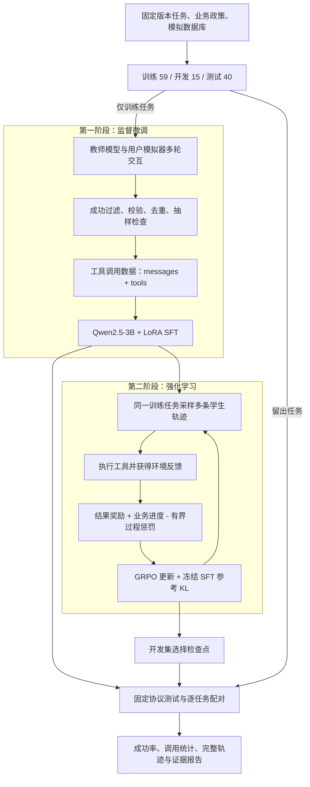

# ServiceAgent-RL

**面向电商客服工具调用的 SFT 与强化学习实践：从教师示范、LoRA 微调，到 GRPO 训练、问题诊断与配对评测。**

本项目基于固定版本的 **tau-bench retail** 环境，以 **Qwen2.5-3B-Instruct** 为学生模型，在单张 **RTX 4090 D 24GB** 上完成 **Base → SFT → SFT + GRPO** 的训练与评测。客服 Agent 需要理解用户诉求、遵守业务政策，在多轮对话中查询订单、确认操作，并调用工具修改模拟业务状态。

项目的两条主线是：

- **监督微调（SFT）**：让教师模型与用户模拟器交互，生成完整客服示范；经过成功过滤、格式校验、去重、长度检查和抽样检查，构建工具调用数据并训练 LoRA。
- **强化学习（RL）**：从同一 SFT 检查点出发，通过 GRPO 优化多轮任务策略；围绕稀疏奖励、策略偏移、采样与训练数值差异、打包注意力掩码开展六组诊断与修复实验。

**已记录的结果**：原始单种子实验中，SFT 将测试成功率从 **7.5% 提高到 20.0%**；后续配对复测中，修复后的 SFT + GRPO 为 **22.50%**，同轮 SFT 基线为 **16.25%**。两轮评测分别报告；后者差值的置信区间包含 0，尚不足以证明稳定提升。详见[实验结果](#实验结果)。

[SFT 工作](#sft教师示范与监督微调) · [强化学习工作](#强化学习grpo-与训练修复) · [快速开始](#快速开始) · [实验记录](experiments/retail-grpo-repair/README.md) · [架构说明](docs/retail_architecture.md)

## 任务与整体流程

环境包含身份查找、用户/订单/商品查询、地址及支付方式修改、取消、退货、换货和转人工等 **16 个工具**。每个任务使用独立的模拟数据库，工具调用会产生实际的模拟状态变更；任务完成情况由官方状态检查及部分任务所需的自然语言裁判共同判定。



学生模型只接收业务政策、工具说明、用户消息和工具反馈。任务标准动作与评分条件保留在环境和奖励计算侧；业务进度奖励仅用于训练。教师、用户模拟器和裁判通过外部 API 调用，只有学生模型在本地更新参数。

## SFT：教师示范与监督微调

SFT 阶段学习如何在客服对话中追问信息、选择工具、生成参数，并结合工具反馈继续处理业务。

| 工作 | 实现内容 |
|---|---|
| 教师示范采集 | 将教师 API 接入官方工具环境，记录多轮消息、工具 Schema、调用参数、执行反馈和任务评分 |
| 数据筛选 | 仅接受训练任务中的成功教师轨迹，排除工具错误、生成截断、消息不配对、重复及来源版本不符的样本 |
| 长度与样本检查 | 训练前用实际 tokenizer 检查完整上下文；正式实验整条排除超长样本，并抽查确认流程及工具参数 |
| LoRA 微调 | 基于 ART/Unsloth 训练 Qwen2.5-3B；保存损失、梯度、监督 token 数、数据及检查点哈希 |
| 独立评测 | 在相同业务环境与评测设置下比较 Base 和 SFT 的任务成功率、工具错误与调用行为 |

**实际完成的 SFT 实验**：59 个训练任务各采样两次，共完成 118 个任务/种子组合；经过自动筛选、16K 长度过滤及 Codex 抽样检查后，最终保留 **58 条示范，覆盖 35 个训练任务**。抽查发现的两条超出工具能力的承诺示范被排除；检查范围及处理依据保存在样本记录中。

训练使用 **4-bit 加载、LoRA rank 16 / alpha 32、batch size 1、学习率峰值 5e-5、2 epochs**，完成 **116 个优化批次**。两个 epoch 的批次平均训练 loss 为 **0.4715 → 0.3487**；任务能力以测试集结果为准。

数据证据：[筛选统计](experiments/retail-3b/data_summary.json) · [样本检查记录](experiments/retail-3b/data_audit.md) · [SFT 训练曲线](experiments/retail-3b/sft_training.png)

## 强化学习：GRPO 与训练修复

RL 阶段让 SFT 学生在环境中自行完成任务：对同一任务采样多条轨迹，根据组内奖励差异计算相对优势，再更新 LoRA。原始二值奖励实验出现大量全失败组，且测试性能下降，后续工作据此展开训练诊断与修复。

| 实验组 | 相对前一方案的主要变化 | 解决的问题 |
|---|---|---|
| A · Outcome | 从原 SFT 权重开始，仅使用官方 0/1 结果奖励 | 建立本轮 RL 训练基线 |
| B · KL | 加入对冻结 SFT 适配器的 KL 约束 | 限制策略偏离已学到的行为 |
| C · Process | 加入有界的重复调用、工具错误、预算耗尽及非法输出惩罚 | 在保留成功优先的前提下提供过程信号 |
| D · Numerics | 统一 BF16 训练/采样基座，使用 FP32 概率归一化，传递打包位置编号 | 降低采样端与训练端的概率差异 |
| E · Progress | 加入仅训练可见的业务进度奖励及对应组筛选规则 | 从有不同业务进展的全失败组中提取学习信号 |
| F · Attention | 修复 Unsloth 覆盖 ART 分支注意力掩码的问题 | 保留打包轨迹之间应有的注意力隔离 |

最终 F 组的训练奖励由三部分组成：

```text
训练奖励 = 官方任务成功（0/1）+ 业务进度奖励（最高 0.5）- 过程惩罚（最高 0.3）
```

业务进度由训练轨迹结束后的离线状态重放计算，包含目标读写操作覆盖及数据库匹配信号。奖励边界保证完整成功轨迹优先于失败轨迹；开发集和测试集仍使用官方成功判定。没有有效组内差异的采样组跳过更新，网络、模拟器或裁判故障单独记录。

训练工程还包括 **优化器及本地随机状态恢复、采样/训练 log-prob 偏差诊断、实际 GPU 前向/反向掩码验证、周期性开发评测及检查点冻结**。A–E 保留为诊断对照，完整测试用于经开发集选定的 F 组。

F 组使用 **24 组 × 4 条轨迹、学习率 2e-6、KL beta 0.02、16K 上下文**，整轮完成 **21 次策略更新**。最终测试选择开发集表现对应的 **step 8（7 次策略更新）**，而非最后权重。本轮沿用原 SFT 检查点，没有重新训练 SFT。

详细记录：[实验协议](experiments/retail-grpo-repair/protocol.md) · [原因分析](experiments/retail-grpo-repair/diagnosis.md) · [完整结果](experiments/retail-grpo-repair/report.md) · [注意力修复报告](experiments/retail-grpo-repair/attention_report.md)

## 实验结果

### 原始实验：Base → SFT → GRPO

同一 Qwen2.5-3B-Instruct、40 个测试任务、单个评测种子：

| 模型阶段 | 成功任务 | 任务成功率 | 出现工具错误的任务比例 | 平均工具调用 |
|---|---:|---:|---:|---:|
| Base | 3/40 | 7.5% | 92.5% | 6.75 |
| LoRA SFT | 8/40 | **20.0%** | 52.5% | 9.75 |
| SFT + 原始 GRPO | 4/40 | 10.0% | 52.5% | 11.57 |

SFT 相对 Base 提高 **12.5 个百分点**；原始 GRPO 相对 SFT 下降 **10.0 个百分点**。该轮结果推动了后续对奖励、数值一致性和注意力掩码的检查。数据来自[原始实验报告](experiments/retail-3b/report.md)。

### 后续复测：SFT → 修复后的 GRPO

在同一批 **40 个测试任务**上，分别使用评测种子 **42、43** 进行配对复测，每个模型共执行 80 次任务：

| 指标 | SFT 基线（本轮重测） | SFT + 修复后的 GRPO |
|---|---:|---:|
| 成功次数 | 13/80 | **18/80** |
| 任务成功率 | 16.25% | **22.50%** |
| 出现工具错误的任务执行比例 | 50.00% | 48.75% |
| 平均工具调用 | 10.250 | 9.588 |
| 重复调用总数 | 199 | 158 |
| 预算耗尽次数 | 44 | 38 |

观察到成功率提高 **6.25 个百分点**；配对执行中，12 次失败转成功、7 次成功转失败。按 40 个任务聚类的 95% bootstrap 差值区间为 **[-5.00, +17.50] 个百分点**，区间包含 0，尚不足以证明稳定提升。

两次评测复用相同任务，本轮只有一个训练种子；测试集属于已知基准上的后续复测。原始实验与本轮复测的 SFT 基线分别报告，避免跨轮次混合比较。平均调用数也受提前失败影响，工具错误比例仅反映可观测工具错误。

结果证据：[完整复测报告](experiments/retail-grpo-repair/attention_report.md) · [逐任务配对](experiments/retail-grpo-repair/paired_test-attention.csv) · [机器可读汇总](experiments/retail-grpo-repair/paired_summary-attention.json)

## 数据与评测设置

- **上游来源**：[Sierra Research tau2-bench](https://github.com/sierra-research/tau2-bench)，固定 commit `5bfa7e37b36656b37dc6d022156be6563c1007f3`；下载时校验 Git blob，并生成 SHA-256 清单。
- **数据内容**：114 个零售任务，及配套订单/商品/用户数据库、业务政策、用户模拟器提示、源码与许可证。SFT 对话通过教师交互生成。
- **任务划分**：保留官方 40 个测试任务，从官方 74 个训练任务中留出开发集，形成 **train 59 / dev 15 / test 40**。按完全相同的用户场景分组；该划分未实现模板族级隔离。
- **正式评测预算**：16K 上下文、单次生成最多 512 tokens、最多 40 步和 5 次工具错误；模型阶段之间固定任务、用户模拟器、裁判和推理设置。
- **记录产物**：对话与工具轨迹、终止原因、官方评分、训练奖励分解、loss/梯度/KL、配置及来源哈希、开发选型和逐任务配对结果。

## 快速开始

环境要求：**Python 3.12、uv**；本地训练另需可用的 NVIDIA GPU。根目录环境用于数据与 API，`runtimes/art/` 环境用于 GPU 训练。以下命令从项目根目录执行。

### 1. 安装并检查数据

全新检出先下载固定版本的上游源码与数据，因为 `tau2` 是本地路径依赖：

```bash
PYTHONPATH=src python -m mini_customer_agent.retail.data
uv sync --extra retail --extra dev --locked
uv run --extra retail --locked retail-agent inspect
uv run --extra retail --locked retail-prepare --verify
```

若环境代理不可用而可以直接联网，下载命令追加 `--direct`。`inspect` 检查数据和官方环境，无需调用模型 API。

### 2. 配置模型与 API

```bash
cp configs/retail.example.json configs/retail.json
cp .env.example .env
```

编辑配置中的模型名、服务地址及 `.env` 中对应的密钥：

| 配置角色 | 用途 |
|---|---|
| `teacher` | 生成训练任务的教师示范 |
| `user` | 模拟客户，补充信息并确认业务操作 |
| `judge` | 评估官方自然语言断言 |
| `art` | 管理本地学生模型、LoRA 和训练检查点 |
| `agent` | 连接自行启动的学生服务，供普通 `evaluate` 命令使用 |

教师使用接口原始模型名；用户和裁判经 LiteLLM 调用，OpenAI 兼容接口使用 `openai/模型名`。密钥通过 `api_key_env` 指定的环境变量读取；`.env` 自动加载，已有环境变量优先。

<details>
<summary>Qwen 流式接口与思考模式配置</summary>

仓库提供 `configs/retail.qwen37.example.json`，其中三个云端角色可共用 `.env` 中的 `DASHSCOPE_BASE_URL` 和 `DASHSCOPE_API_KEY`；各角色单独填写的 `TEACHER_*`、`USER_*`、`JUDGE_*` 配置优先。请按实际服务填写地址和密钥。

```bash
# 检查教师文本接口
uv run --extra retail --locked retail-agent \
  --config configs/retail.qwen37.example.json probe

# 仅本次检查启用思考，并分别显示思考文本与回复
uv run --extra retail --locked retail-agent \
  --config configs/retail.qwen37.example.json \
  probe --thinking --show-reasoning --max-tokens 8192
```

该配置默认教师流式输出、关闭思考；用户和裁判使用非流式调用。适配器拼接文本及工具参数，正常 SFT 消息不包含教师思考文本。`probe` 只验证文本接口，工具执行、模拟器与裁判仍需通过 `collect` 检查。正式对照应固定模型快照及思考设置。

</details>

### 3. 采集示范并构建 SFT 数据

```bash
# 先用 3 个训练任务检查完整交互
uv run --extra retail --locked retail-agent --config configs/retail.json \
  collect --limit 3 --trials 1

# 检查通过后，采集全部 59 个训练任务，每个任务两次
uv run --extra retail --locked retail-agent --config configs/retail.json \
  collect --trials 2

# 将路径替换为上一步输出的实际采集目录
uv run --extra retail --locked retail-agent --config configs/retail.json \
  build-sft --traces traces/retail/实际采集目录/traces.jsonl \
  --output data/sft/train.jsonl
```

构建器同时生成来源清单。训练前检查样本长度，并抽查身份、用户确认及退换货规则；同一任务的重复采样仍属于同一场景。

### 4. 单卡运行 Base → SFT → GRPO

```bash
uv sync --project runtimes/art --locked
uv run --project runtimes/art --locked retail-agent prepare-inference

# 使用已下载的 Qwen2.5-3B-Instruct，建立兼容工具参数格式的模型视图
uv run --extra retail --locked retail-agent prepare-model \
  --model /path/to/Qwen2.5-3B-Instruct
```

将返回路径写入 `configs/retail.json` 的 `art.base_model`。模型视图通过符号链接引用原始权重，并修正工具参数模板。正式实验使用 `art.max_seq_length=16384`；训练前长度检查遇到超长样本会停止。`prepare-inference` 仅检查已安装版本。

```bash
export CUDA_VISIBLE_DEVICES=0  # 替换为一张可用 GPU

# 新 art.name 没有检查点时，评测 Base
uv run --project runtimes/art --locked retail-agent --config configs/retail.json \
  train --stage evaluate --split dev --limit 15

# SFT：同一 art.name 继续用于后续 RL
uv run --project runtimes/art --locked retail-agent --config configs/retail.json \
  train --stage sft --dataset data/sft/train.jsonl --epochs 2

# 保存 SFT 的独立评测
uv run --project runtimes/art --locked retail-agent --config configs/retail.json \
  train --stage evaluate --split dev --limit 15

# 小规模 GRPO，验证采样与更新流程
uv run --project runtimes/art --locked retail-agent --config configs/retail.json \
  train --stage grpo --steps 5 --limit 3

uv run --project runtimes/art --locked retail-agent --config configs/retail.json \
  train --stage evaluate --split dev --limit 15
```

上述通用配置用于跑通流程，默认 4-bit、每任务 2 条 rollout、结果奖励；它与最终 F 组的 BF16、4 条 rollout、KL、业务进度及掩码修复设置不同。复现实验请对照[原始协议](experiments/retail-3b/protocol.md)和[修复协议](experiments/retail-grpo-repair/protocol.md)，并替换实验配置中的本机模型及 SFT 参考检查点路径。

`--steps` 表示采样组数，实际策略更新数以 `updates.jsonl` 为准。新对照使用新的 `art.name`。`train --stage evaluate` 评测当前最新检查点，需在进入下一阶段前保存阶段结果；正式测试使用冻结候选及 `--split test --limit 40`。

训练栈通过锁文件固定：**ART 0.5.16、PyTorch 2.9.1 / CUDA 12.8、Transformers 4.57.3、Unsloth 2025.12.9、vLLM 0.15.1**。本地脚本封装与部署记录见[运行说明](docs/local_setup.md)。

### 5. 检查与报告

```bash
# 回归测试与官方工具环境离线联调
uv run --extra retail --extra dev --locked python -m unittest discover -s tests -v

# 已有原始轨迹时，重建修复实验报告，不启动模型
uv run --extra retail --locked python scripts/report_retail_grpo_repair.py
uv run --extra retail --locked python scripts/report_retail_attention.py
```

## 项目结构

```text
src/mini_customer_agent/retail/   # 当前主流程
├── data.py / dataset.py         # 固定版本下载、任务划分、SFT 数据构建
├── rollout.py / worker.py       # 多轮对话、工具执行、独立任务进程
├── training.py                 # ART SFT / GRPO / 评测入口
├── rewards.py                  # 结果奖励与有界过程惩罚
├── business_progress.py        # 训练专用业务进度奖励
├── art_service.py              # 本地训练服务及打包注意力适配
├── art_numerics.py / logprobs.py # 数值一致性与概率诊断
├── optimizer_state.py          # 优化器与随机状态保存恢复
└── reporting.py                # 轨迹、指标和来源记录

configs/                        # 可复用配置模板
runtimes/art/                   # 隔离的 GPU 训练环境及锁文件
scripts/                        # 阶段运行、诊断、绘图及证据核验
experiments/retail-3b/           # 原始 Base / SFT / GRPO 实验
experiments/retail-grpo-repair/  # 六组诊断、修复及最终配对复测
tests/                          # 数据、工具环境、奖励与训练适配测试
docs/                           # 架构、运行和历史说明
```

运行时生成 `third_party/tau2-bench/`（上游环境）、`data/sft/`（示范数据）、`traces/retail/`（交互轨迹）及 `.art/`（权重、优化器和训练状态）。这些目录默认不提交 Git，完整训练和报告重建需要相应本地产物。仓库中的实验报告、统计表及来源清单用于展示与核对已完成的工作。

## 文档与适用范围

| 文档 | 内容 |
|---|---|
| [架构说明](docs/retail_architecture.md) | 模型角色、数据流、工具执行与训练边界 |
| [原始实验](experiments/retail-3b/report.md) | Base / SFT / GRPO 对照、训练曲线与行为案例 |
| [修复实验导航](experiments/retail-grpo-repair/README.md) | 实验协议、六组结果、检查点选择与证据文件 |
| [最终复测](experiments/retail-grpo-repair/attention_report.md) | 两个评测种子的配对结果及统计区间 |
| [本地运行说明](docs/local_setup.md) | 阶段脚本、依赖和早期部署记录 |
| [历史 Mini Harness](docs/legacy_harness.md) | 原四工具环境及 TRL 示例 |

当前成果覆盖模拟零售环境中的训练、评测和诊断，尚未接入生产订单系统。全面政策违规率及供应商实际费用尚未可靠测量；后续可通过增加独立任务和训练种子、完善合规检查与成本统计来扩展验证。

感谢上游 **tau-bench / tau2-bench、Qwen、OpenPipe ART、Unsloth 和 vLLM** 提供的环境、模型与训练推理基础设施。下载的上游源码及数据保留对应许可证。
