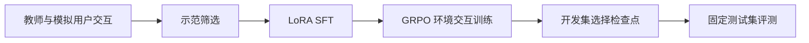

# ServiceAgent-RL

**单卡训练的电商客服 Agent：LoRA SFT + GRPO 强化学习。**

电商客服中的退换货、订单取消和地址修改，通常需要跨多轮对话补充信息、核验订单状态、确认用户意愿，再按业务规则调用工具。一次参数错误或步骤遗漏，都可能影响最终处理结果。因此，客服 Agent 需要同时掌握业务流程、工具使用和多步决策。

**SFT 通过优质示范建立业务处理与工具调用的基础；强化学习以实际任务结果和业务进度为反馈，进一步优化操作顺序、错误恢复及任务完成策略。** 本项目围绕这两个阶段，探索从示范学习到环境交互的客服 Agent 训练方法。

基于 **Qwen2.5-3B-Instruct** 和 **tau-bench retail**，构建从教师示范采集、监督微调到强化学习与任务评测的完整流程。Agent 在多轮对话中理解需求、确认操作，调用工具完成订单查询、地址修改、取消、退货及换货等业务。

## 项目亮点

- **SFT + RL 完整训练链路**：通过教师示范学习工具调用，再通过环境交互优化任务策略。
- **业务状态驱动的奖励**：结合任务成功、业务进度和有界过程惩罚，为多轮决策提供学习信号。
- **单卡参数高效训练**：在一张 RTX 4090 D 24GB 上完成 3B 模型的 LoRA 微调与 GRPO，支持 16K 上下文。
- **完整工具执行与可追溯评测**：接入官方 16 个工具，保存对话、工具反馈、奖励和检查点记录，支持逐任务配对比较。

## 最终方案



### SFT：学习客服工具调用

教师模型在官方零售环境中生成多轮示范，经成功过滤、格式校验、去重、长度检查和抽样检查，构建 `messages + tools` 训练数据。最终使用 **58 条示范、覆盖 35 个训练任务**，通过 **4-bit 加载 + LoRA（rank 16）** 完成 **2 epochs** 监督微调。

### 强化学习：优化多轮任务策略

从 SFT 检查点出发，对同一任务采样 **4 条轨迹**，使用 **GRPO** 进行组内相对优势优化，并以冻结 SFT 模型的 **KL 约束**限制策略偏移。

```text
训练奖励 = 官方任务成功 + 业务进度奖励 - 有界过程惩罚
```

业务进度奖励基于训练轨迹的目标操作覆盖及数据库状态；过程惩罚约束重复调用、工具错误和预算耗尽，奖励设计保持完整成功优先。训练采用 **BF16 基座、FP32 概率归一化和打包轨迹注意力隔离**，支持优化器与随机状态恢复。最终检查点由开发集选择，测试使用官方任务成功判定。

## 核心结果

在相同 **40 个测试任务 × 2 个评测种子**上进行配对复测，每个模型共执行 80 次任务：

| 指标 | SFT | SFT + GRPO |
|---|---:|---:|
| 任务成功率 | 16.25%（13/80） | **22.50%（18/80）** |
| 平均工具调用次数 | 10.250 | **9.588** |
| 重复调用总数 | 199 | **158** |
| 预算耗尽次数 | 44 | **38** |

本轮观察到成功率提高 **6.25 个百分点**。本轮仅一个训练种子，两次评测复用相同任务；按任务聚类的 95% bootstrap 差值区间为 **[-5.00, +17.50] 个百分点**，尚不足以证明稳定提升。完整评测条件与逐任务结果见[结果报告](experiments/retail-grpo-repair/attention_report.md)。

## 快速开始

需要 **Python 3.12、uv**；训练另需 NVIDIA GPU。先下载固定版本的上游环境，再安装本地路径依赖：

```bash
PYTHONPATH=src python -m mini_customer_agent.retail.data
uv sync --extra retail --extra dev --locked
uv run --extra retail --locked retail-agent inspect

cp configs/retail.example.json configs/retail.json
cp .env.example .env
```

在配置中填写教师、模拟用户和裁判的模型及地址，在 `.env` 中填写密钥；`art` 配置管理本地学生模型。GPU 训练环境单独安装：

```bash
uv sync --project runtimes/art --locked
uv run --project runtimes/art --locked retail-agent prepare-inference
```

数据沿用固定版本官方任务，划分为 **train 59 / dev 15 / test 40**。完整采集、训练和评测命令见[详细指南](README.detailed-2026-10-15.md#快速开始)；通用示例配置用于跑通流程，最终训练设置见[实验协议](experiments/retail-grpo-repair/protocol.md)。

## 代码与文档

| 入口 | 内容 |
|---|---|
| [核心代码](src/mini_customer_agent/retail/) | 数据构建、多轮交互、SFT / GRPO、奖励与评测 |
| [配置模板](configs/retail.example.json) | API 角色及本地模型配置 |
| [架构说明](docs/retail_architecture.md) | 模型角色、工具环境与数据流 |
| [结果报告](experiments/retail-grpo-repair/attention_report.md) | 最终方案的配对测试结果 |


基于 [tau2-bench](https://github.com/sierra-research/tau2-bench)、Qwen、OpenPipe ART、Unsloth 和 vLLM 构建；上游源码与数据保留对应许可证。
